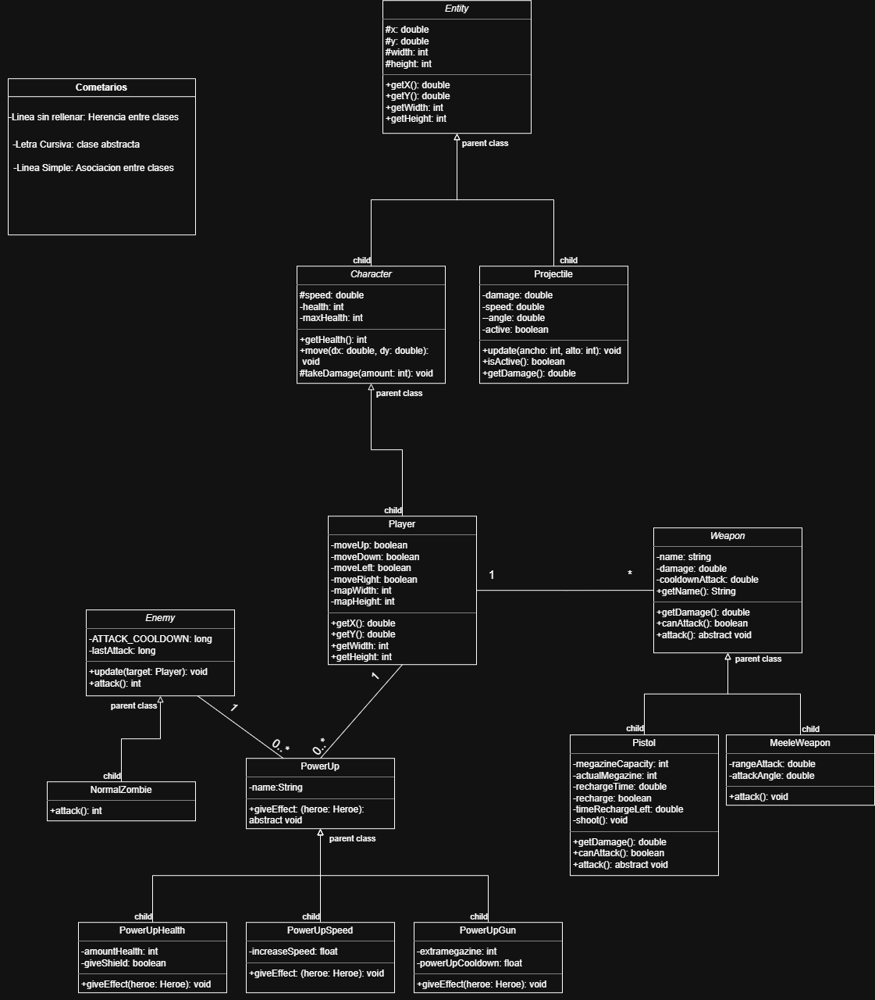
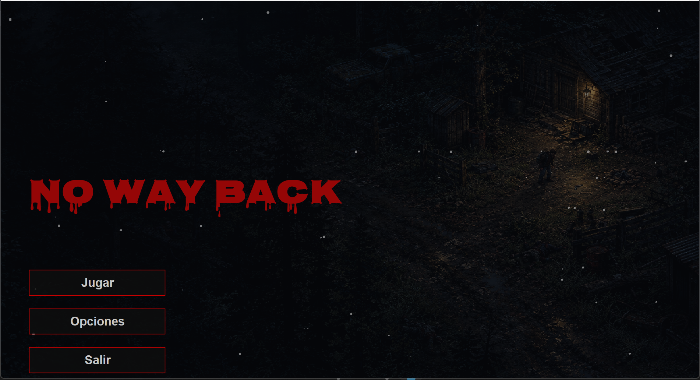
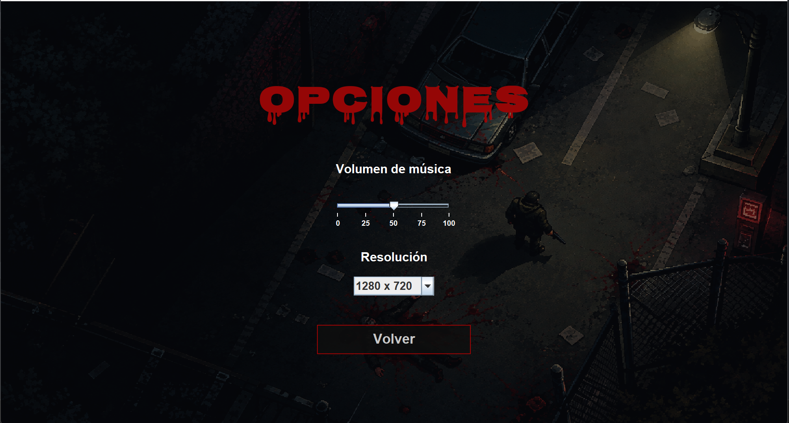
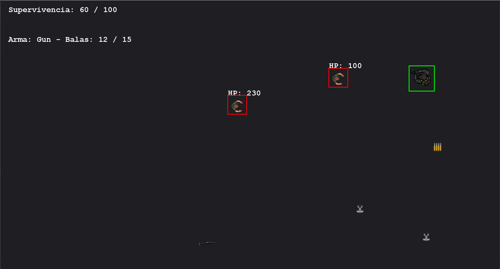
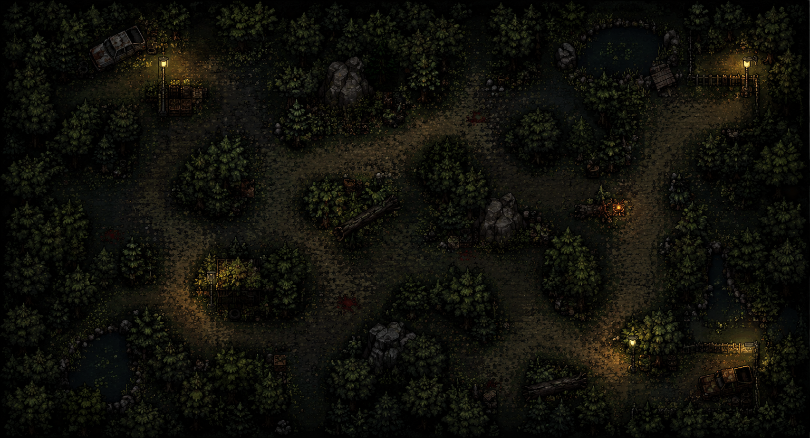
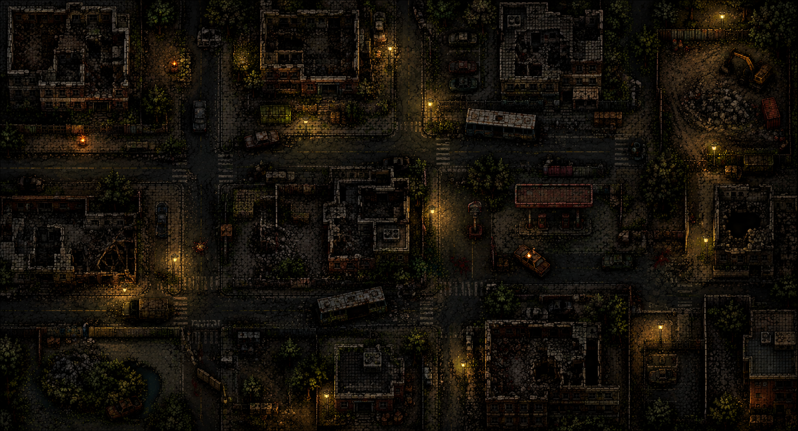
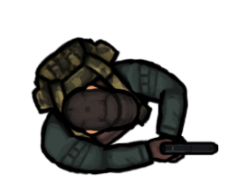
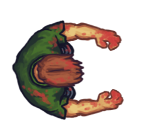

# Proyecto-Final-POO-2026

# Proyecto: Cazador de Zombies (Nombre a definir)

## 1. Integrantes del Equipo 

- Kornijew, Mirko 
- Navarro, Thiago 
- Perez, Joaquin 
- Oyarzo, Emiliano

## 2. Dominio y Alcance del Sistema 

### Descripción del problema
Se busca desarrollar una aplicación de escritorio de un videojuego de tipo **roguelike**, específicamente enfocado en la exploración de mazmorras y la acción frenética, ambientado en un mundo de apocalipsis zombie. El jugador tomará el control de un sobreviviente al apocalipsis que debe eliminar zombies en diferentes salas para sobrevivir.

### Objetivo del Sistema
El sistema será un juego funcional y extensible. El diseño aplicará rigurosamente la arquitectura **MVC**, los principios de la Programación Orientada a Objetos (POO) y patrones de diseño para facilitar la incorporación de nuevos personajes, habilidades, mapas y persistencia de datos.
 El objetivo del juego es eliminar al jefe final. Para esto debe encontrar una llave por cada nivel para acceder al siguiente. Al llegar a una determinada cantidad de salas completadas, se encuentra con un jefe al que tiene que eliminar.

### Idea general
El jugador es un sobreviviente de un apocalipsis zombie caminando por un mapa en 2D de perspectiva top-down donde aparecen justamente zombies que le quieren hacer daño y él se tiene que defender, para eso cuenta con un arma de fuego y un cuchillo. El arma de fuego tiene balas y cooldown, en cada nivel aparece con una cantidad default de balas y se puede ir encontrando más de las mismas, además de otros potenciadores o power ups como por ejemplo de velocidad o escudo. También podría encontrarse otras armas mejores que sean más eficientes y faciliten la jugabilidad. Todo esto el jugador lo utiliza para derrotar a los enemigos de cada nivel, y al eliminarlos a todos debe derrotar a un jefe final para pasar al siguiente nivel. 
 El juego cuenta con varios escenarios en donde se desarrollaran los niveles del juego y también con variedad en cuanto a los enemigos como distintos tipos de zombies que tendrán mecánicas propias que los hagan únicos.

### Funcionalidades Principales (Features)

**Gestión de Personajes y Clases:**
- Control de personajes con atributos propios (Vida, Ataque).
- Variedad de armas con formas de disparo diferentes.

**Interacciones con el entorno:**
- El jugador inicia con dos armas, una es para que tenga capacidad de hacer daño a los zombies a larga distancia, hay que tener cuidado porque estas balas tienen un límite, fomentando al jugador a usar cada bala con cuidado y con consciencia. La otra arma es un cuchillo con el que va a poder golpear a melee (ataque cuerpo a cuerpo)
- El jugador puede llegar a conseguir potenciadores o power-ups que se encuentran dispersos alrededor del mapa, estos incrementan sus stats ya sea de velocidad, cooldown del arma, más balas, etc. Beneficiando al jugador y dándole ventaja contra la situación. 
- Cuando entran a las salas donde están los enemigos las puertas se cierran, obligando al jugador a eliminarlos a todos para poder irse.

 **Mecánicas de Juego:**
- Si los zombies atacan al jugador, le quitan 1 corazón de 5 que representa su vida.
- Ciertos enemigos al ser eliminados dejan caer balas o power-ups.
- Hay salas donde hay cofres que tienen armas dentro o una tienda donde se puedan comprar armas, vida o power ups.

**Interfaz Gráfica (IGU):**
- Visualización del mapa (bosque, edificios, etc.), en perspectiva top-down.
- Indicadores visuales de estado (barra de vida, cantidad de munición, power ups activos).
- Botón para iniciar la partida.

**Creación de enemigos:**
- Oleadas de una cantidad aleatoria de zombies dependiendo la mazmorra donde se encuentre.

**Persistencia de datos:**
- Guardado y consulta de mejores puntuaciones (High Scores) en una base de datos SQLite.

### Diagramas de Diseño

#### **Diagrama de Clases UML (Conceptual)**

#### **Prototipo de la IGU (Wireframe)**

*Menu principal*

*Opciones menu principal*

*Jugabilidad*

En esta imágen se pueden ver dos tipos de zombies, un tipo distinto de arma en el suelo y varios power-ups que se pueden recoger. Falta pulir el diseño e implementar el mapa.

*Mapa del bosque (posible diseño nivel 1)*

*Mapa de la ciudad (posible diseño nivel 2)*

*Jugador*

*Zombie*

## 4. Stack Tecnológico  

- **Lenguaje:** Java 26
- **IDE:** Visual Studio Code & Intellij IDEA
- **Base de Datos:** SQL Lite
- **Framework de IGU:** Java Swing
- **Control de Versiones:** Git y GitHub Classroom

## Herencia y Polimorfismo

## Herencia
**Entity (abstracta) → Character, Bullet, WeaponItem, PowerUp:**
- Todo lo que existe en el mapa (jugador, zombies, etc.) tiene una posición en el mapa (x, y) y un tamaño (width, height), y necesita poder calcular su rectángulo de colisión. En lugar de repetir esos métodos y atributos en cada clase, se los guarda una vez en Entity.

**Character (abstracta, extiende de Entity) → Player, Enemy:**
-  El jugador y los enemigos comparten algo que las demás clases no tienen, vida y la capacidad de recibir daño y morir. Por eso se guardó en una clase, de tal manera que no se reutilize código.

**Enemy (abstracta, extiende Character) → NormalZombie, FastZombie, TankZombie, PoisonZombie:**
- Todo enemigo persigue al jugador de la misma forma (update (Player target)), lo que ya está escrito una vez en Enemy, además que ataca por contacto con un mecanismo de cooldown. Lo único que cada tipo de zombie define es cuanto daño hace mediante el método abstracto attack() o, en su defecto, define mecánicas especiales como disparar veneno.

**Weapon (abstracta) → FireArm(abstracta), MeleeWeapon:**
- Se creó una jerarquía abstracta para las armas. Todas comparten el daño y el tiempo de recarga (cooldown) en la clase padre Weapon. El cuchillo hereda directamente como arma cuerpo a cuerpo (MeleeWeapon).

**FireArm (abstracta, extiende Weapon) → Gun, ShotGun, Rifle**
- Las armas de fuego extienden de Weapon, pero le agregan la lógica de la munición (balas actuales y capacidad máxima) e implementan la interfaz AmmoHolder. De ella heredan armas concretas que definen su propio comportamiento de disparo.

**Bullet (extiende de Entity) → MeleeHitbox:**
- El ataque cuerpo a cuerpo reutiliza el sistema de proyectiles, pero en lugar de ser una bala que viaja por el mapa, se anula su movimiento y se configura un año de daño más grande que desaparece después de pocos fotogramas.

**PowerUp (abstracta, extiende de Entity) → Ammo, Heal, Shield, DamageBoost, MaxAmmo:**
- Todos los potenciadores que el jugador puede recoger del suelo son una entidad y comparten el estado activo y la lógica base de recolección (collect). Cada subclase define su propio comportamiento específico mediante el método abstracto apply(Player player).

**SplashPanel (abstracta, extiende de JPanel) → SplashUniversity, SplashSubject:**
- En el sistema de menús, se creó un panel base que configura el layout y el color de fondo para las pantallas de carga. De ella heredan las vistas que solo se encargan de inicializar y dibujar sus componentes específicos (logo de la universidad y título de la materia.).

## Polimorfismo 
**Enemy.attack():**
- Enemy.update() llama a attack() sin saber ni importarle que tipo de zombi es, más adelante cuando se agreguen más tipos de zombies esto va a ser más visible. Pero el mecanismo ya es polimórfico, cuando se agregue otro tipo de zombie, Enemy.update() no va a tener que cambiar ninguna línea de código para que el ataque sea distinto. El código que lo usa no sabe cuantas variantes existen, y no le hace falta saberlo.

**Weapon.shoot()**
- Al tener distintos tipos de armas equipadas, el jugador (Player) simplemente delega la acción llamando a activeWeapon.shoot(...) sin saber cuál arma tiene en la mano. A través de este mismo llamado polimórfico, el cuchillo genera una caja de colisión (MeleeHitbox), la pistola genera una sola bala, y la escopeta (ShotGun) genera múltiples perdigones dispersos.

**PowerUp.apply()**
- Cuando el jugador choca con un power-up en el piso, se llama al método collect(player). No se necesita usar condicionales para averiguar qué tipo de power-up levantó, cada objeto se encarga de aplicar su propio efecto (curar, dar escudo, recargar munición o aumentar el daño) con un único mensaje.
