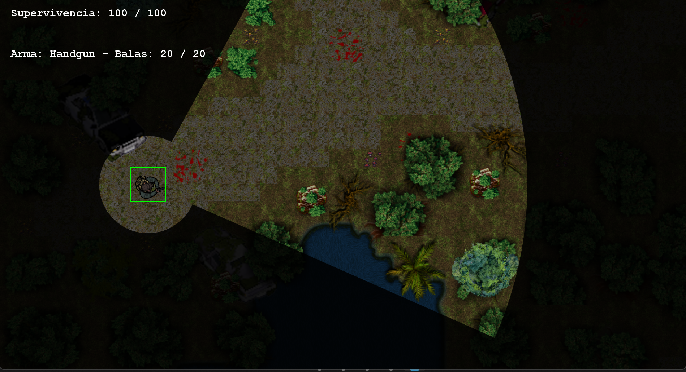
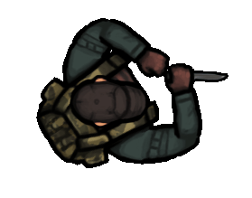
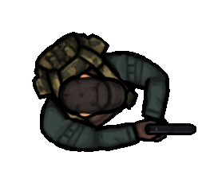
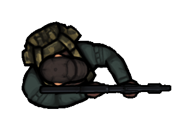
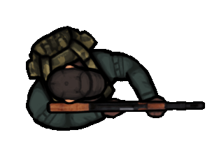
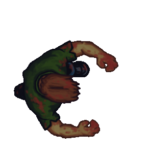
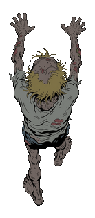
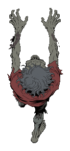
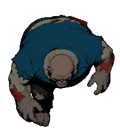
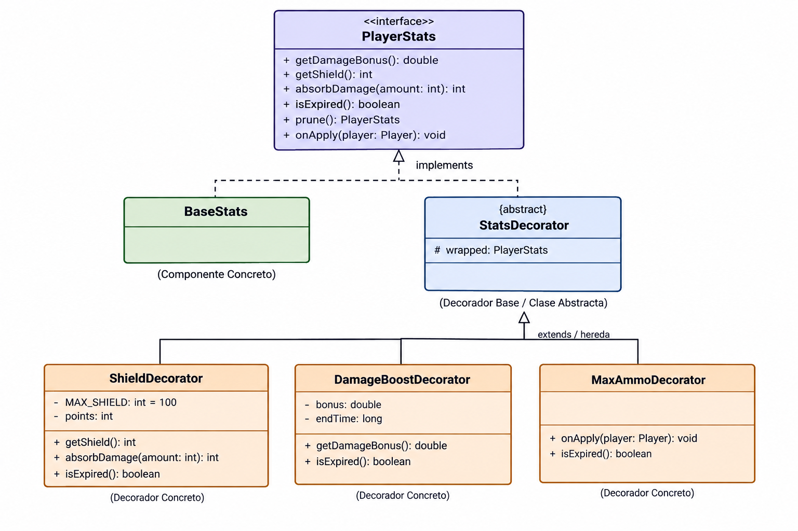

# Proyecto-Final-POO-2026

# Proyecto: Cazador de Zombies (Nombre a definir)

## 1. Integrantes del Equipo 

- Kornijew, Mirko 
- Navarro, Thiago 
- Perez, Joaquin 
- Oyarzo, Emiliano

## 2. Dominio y Alcance del Sistema 

### Descripción del problema
Se busca desarrollar una aplicación de escritorio de un videojuego de acción y supervivencia con perspectiva **top-down**, ambientado en un apocalipsis zombie. El jugador tomará el control de un sobreviviente que debe defenderse de oleadas de enemigos en un entorno abierto. Para sobrevivir y avanzar, deberá gestionar estratégicamente su posicionamiento y visión limitada, administrar recursos finitos como la munición, recolectar armamento y potenciadores del entorno, y finalmente derrotar a un jefe para completar el nivel.

### Objetivo del Sistema
El sistema será un juego funcional y extensible. El diseño aplicará rigurosamente la arquitectura **MVC** y los principios de la Programación Orientada a Objetos (POO) para facilitar la incorporación de nuevos personajes, armas, mapas y mecánicas a futuro.
El objetivo principal del juego es sobrevivir y derrotar a un jefe final. Para lograrlo, el jugador debe enfrentarse a una oleada de enemigos dentro de un mapa abierto. Una vez que logra resistir la oleada y eliminar a una cantidad predeterminada de zombies, se desencadenará un encuentro con el jefe final, al cual deberá eliminar para completar el nivel con éxito.

### Idea general
El jugador controla a un sobreviviente de un apocalipsis zombie que explora un nivel único (ambientado en un bosque) en 2D con perspectiva top-down. El objetivo principal es sobrevivir a una oleada de enemigos y, finalmente, derrotar al jefe del mapa para ganar el juego. Para defenderse, el jugador inicia con una pistola —la cual cuenta con munición limitada y tiempo de recarga (cooldown)— y un cuchillo para ataques cuerpo a cuerpo.   Durante la partida, el jugador deberá sobrevivir bajo un efecto de visión limitada que oscurece el entorno. Explorando el mapa, podrá encontrar y equipar armas de fuego más eficientes tiradas en el suelo (como rifles y escopetas) para facilitar el combate. Además, el escenario genera aleatoriamente diversos potenciadores (power-ups) que otorgan ventajas tácticas, tales como curación de vida, escudos protectores, aumento temporal de daño y recargas de munición. 

### Funcionalidades Principales (Features)

**Gestión de Personajes y Clases:**
- Control de personajes con atributos propios (Vida, Ataque).
- Variedad de armas con formas de disparo diferentes.

**Interacciones con el entorno:**
- El jugador inicia con dos armas, una es para que tenga capacidad de hacer daño a los zombies a larga distancia, hay que tener cuidado porque estas balas tienen un límite, fomentando al jugador a usar cada bala con cuidado y con consciencia. La otra arma es un cuchillo con el que va a poder golpear a melee (ataque cuerpo a cuerpo)
- El jugador puede llegar a conseguir potenciadores o power-ups que se encuentran dispersos alrededor del mapa, estos incrementan sus stats ya sea de velocidad, cooldown del arma, más balas, etc. Beneficiando al jugador y dándole ventaja contra la situación. 

 **Mecánicas de Juego:**
- Visión Limitada: El jugador experimenta un efecto de oscuridad en pantalla, restringiendo su campo de visión mediante un cono de luz guiado por el cursor y un pequeño radio a su alrededor, lo que fomenta la precaución.
- Gestión de Arsenal: Intercambio fluido entre el arma de fuego equipada y el arma cuerpo a cuerpo (cuchillo) usando una tecla dedicada.
- Recolección de Botín (Loot): Recogida dinámica de nuevas armas (rifles, escopetas) esparcidas por el mapa, reemplazando el arma actual e instanciando la antigua en el suelo.
- Sistema de Potenciadores (Power-Ups): Generación aleatoria de mejoras que el jugador puede recolectar al tocarlas, obteniendo beneficios como curación, escudos absorbe-daño, recarga de munición y multiplicadores de daño temporal.
- Combate Diferenciado: Cada arma posee características únicas (daño, dispersión, munición, disparo automático o semiautomático) implementadas mediante polimorfismo.
- Oleadas y Jefe Final: Los enemigos se generan (spawnean) en un perimetro. Al limpiar la oleada, se invoca al Jefe Final (con cinemática de texto y pantalla oscurecida).
- IA de Enemigos Básica: Comportamiento de persecución (Pathfinding directo al jugador) con detección de colisiones simples para evitar solapamiento masivo entre los propios zombies.
- Sistema de Daño y Escudos: El jugador recibe daño al contacto físico (melee) o por proyectiles venenosos. Los puntos de escudo absorben daño antes de afectar la vida (HP) del personaje.

**Interfaz Gráfica (IGU):**
- Cámara y Entorno: Visualización del mapa (bosque) en perspectiva top-down mediante una cámara dinámica que sigue al jugador y orienta al personaje en la dirección del cursor del mouse.
- HUD (Head-Up Display): Indicadores en pantalla que muestran estadísticas en tiempo real: puntos de supervivencia (vida), cantidad de escudo activo, bonificadores de daño temporal y el estado de la munición del arma equipada.
- Sistema de Menús: Flujo de navegación estructurado con pantallas de presentación (Splash Screens), un menú principal con animaciones de partículas de fondo (cenizas), y un menú de opciones funcional para ajustar el volumen general y la resolución de la ventana.
- Efectos Visuales y Renderizado: Implementación avanzada mediante **Graphics2D** que incluye iluminación dinámica (cono de visión del jugador), estelas de trayectoria para los proyectiles (tracers), destellos al disparar armas de fuego, y animaciones de flotación y brillo para identificar los potenciadores en el suelo.

**Creación de enemigos:**
- Oleadas de una cantidad aleatoria de zombies.

**Persistencia de datos:**
- Guardado y consulta de mejores puntuaciones (High Scores) en una base de datos SQLite.

### Diagramas de Diseño

#### **Diagrama de Clases UML (Conceptual)**

#### **Prototipo de la IGU (Wireframe)**

*Menu principal*

*Opciones menu principal*

*Jugabilidad*

En esta imágen se pueden ver dos tipos de zombies, un tipo distinto de arma en el suelo y varios power-ups que se pueden recoger. Falta pulir el diseño e implementar el mapa.

*Interfaz / Visibilidad*

*Mapa del bosque (posible diseño nivel 1)*

*Los tamaños de los zombies están sujetos a dimensiones in-game*

### Superviviente
| Cuchillo | Pistola | Escopeta | Rifle |
| :---: | :---: | :---: | :---: |
|  |  |  |  |

### Zombis
| Zombi Normal | Zombi Rápido | Zombi Venenoso | Zombi Tanque |
| :---: | :---: | :---: | :---: |
|  |  |  |  |

## 4. Stack Tecnológico  

- **Lenguaje:** Java 26
- **IDE:** Visual Studio Code & Intellij IDEA
- **Base de Datos:** SQL Lite
- **Framework de IGU:** Java Swing
- **Control de Versiones:** Git y GitHub Classroom

## Herencia y Polimorfismo

## Herencia
**Entity (abstracta) → Character, Bullet, WeaponItem, PowerUp:**
- Todo lo que existe en el mapa (jugador, zombies, etc.) tiene una posición en el mapa (x, y) y un tamaño (width, height), y necesita poder calcular su rectángulo de colisión. En lugar de repetir esos métodos y atributos en cada clase, se los guarda una vez en Entity.

**Character (abstracta, extiende de Entity) → Player, Enemy:**
-  El jugador y los enemigos comparten algo que las demás clases no tienen, vida y la capacidad de recibir daño y morir. Por eso se guardó en una clase, de tal manera que no se reutilize código.

**Enemy (abstracta, extiende Character) → NormalZombie, FastZombie, TankZombie, PoisonZombie:**
- Todo enemigo persigue al jugador de la misma forma (update (Player target)), lo que ya está escrito una vez en Enemy, además que ataca por contacto con un mecanismo de cooldown. Lo único que cada tipo de zombie define es cuanto daño hace mediante el método abstracto attack() o, en su defecto, define mecánicas especiales como disparar veneno.

**Weapon (abstracta) → FireArm(abstracta), MeleeWeapon:**
- Se creó una jerarquía abstracta para las armas. Todas comparten el daño y el tiempo de recarga (cooldown) en la clase padre Weapon. El cuchillo hereda directamente como arma cuerpo a cuerpo (MeleeWeapon).

**FireArm (abstracta, extiende Weapon) → Gun, ShotGun, Rifle**
- Las armas de fuego extienden de Weapon, pero le agregan la lógica de la munición (balas actuales y capacidad máxima) e implementan la interfaz AmmoHolder. De ella heredan armas concretas que definen su propio comportamiento de disparo.

**Bullet (extiende de Entity) → MeleeHitbox:**
- El ataque cuerpo a cuerpo reutiliza el sistema de proyectiles, pero en lugar de ser una bala que viaja por el mapa, se anula su movimiento y se configura un año de daño más grande que desaparece después de pocos fotogramas.

**PowerUp (abstracta, extiende de Entity) → Ammo, Heal, Shield, DamageBoost, MaxAmmo:**
- Todos los potenciadores que el jugador puede recoger del suelo son una entidad y comparten el estado activo y la lógica base de recolección (collect). Cada subclase define su propio comportamiento específico mediante el método abstracto apply(Player player).

**SplashPanel (abstracta, extiende de JPanel) → SplashUniversity, SplashSubject:**
- En el sistema de menús, se creó un panel base que configura el layout y el color de fondo para las pantallas de carga. De ella heredan las vistas que solo se encargan de inicializar y dibujar sus componentes específicos (logo de la universidad y título de la materia.).

## Polimorfismo 
**Enemy.attack():**
- Enemy.update() llama a attack() sin saber ni importarle que tipo de zombi es, más adelante cuando se agreguen más tipos de zombies esto va a ser más visible. Pero el mecanismo ya es polimórfico, cuando se agregue otro tipo de zombie, Enemy.update() no va a tener que cambiar ninguna línea de código para que el ataque sea distinto. El código que lo usa no sabe cuantas variantes existen, y no le hace falta saberlo.

**Weapon.shoot()**
- Al tener distintos tipos de armas equipadas, el jugador (Player) simplemente delega la acción llamando a activeWeapon.shoot(...) sin saber cuál arma tiene en la mano. A través de este mismo llamado polimórfico, el cuchillo genera una caja de colisión (MeleeHitbox), la pistola genera una sola bala, y la escopeta (ShotGun) genera múltiples perdigones dispersos.

**PowerUp.apply()**
- Cuando el jugador choca con un power-up en el piso, se llama al método collect(player). No se necesita usar condicionales para averiguar qué tipo de power-up levantó, cada objeto se encarga de aplicar su propio efecto (curar, dar escudo, recargar munición o aumentar el daño) con un único mensaje.

## Implementacion de patron "Decorator" para power ups
 **problema que tenian los power ups
 Cada power up dejaba rastro en clases que no son suyas

-Player guardaba el estado de cada powerup: shield, MAX_SHIELD, damage	Bonus, addShield() y setDamageBonus(), y takeDamage tenia la logica del escudo metida adentro. Para sumar un power up nuevo había que tocar Player , y eso rompe abierto/cerrado

-Habian tres mecanismos distintos para lo mismo: el escudo era un campo, el boost  de danio era un Effect con Apply/Remove que sumaba y restaba sobre un campo compartido, y la municion iba por ammoHolder.

-La logica de danio estaba repartida entre las armas: cada arma tenia que acordarse de sumas player.getDamageBonus().shotGun se olvido: usaba solo getDamage, asi que el DamageBoost no funcionaba con la escopeta. Es un bug que sale de esa estructura

-Shield  tenia un tipo: super(32, 32) ignoraba x e y, asi  que el power Up de escudo siempre aparecia en la esquina (32, 32).

**¿ como se resolvio el problema? usando decorator
 El jugador pasa a tener un PlayerStats, y cada power up es un decorador que envuelve al anterior
 -BaseStats es el objeto base: el jugador sin power ups.

-Player guarda una sola referencia a la capa de afuera, el campo stats. Cuando le pregunta stats.getShield(), la consulta recorre la cadena hacia adentro.

-El objeto decorado es Player.stats, no player

El objeto decorado es Player.stats y no el objeto Player completo. Se optó por decorar únicamente las estadísticas de combate del jugador porque el estado del juego (GameState), el controlador y la vista trabajan directamente con una instancia concreta de Player. Envolver al jugador entero con decoradores habría obligado a modificar múltiples componentes del sistema. Encapsular los power-ups en un objeto independiente (PlayerStats) logra el mismo efecto dinámico sin acoplar ni alterar el resto de la arquitectura.

