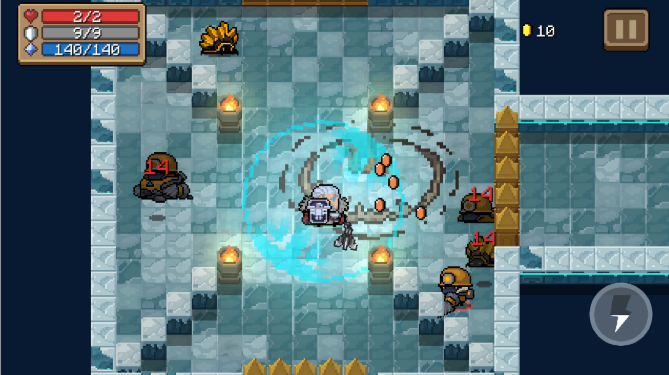
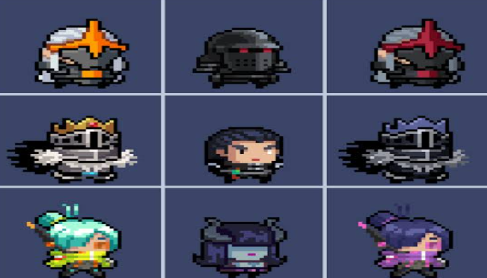
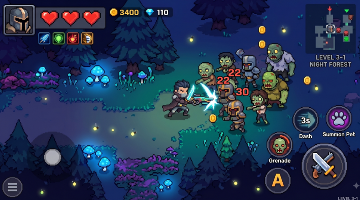
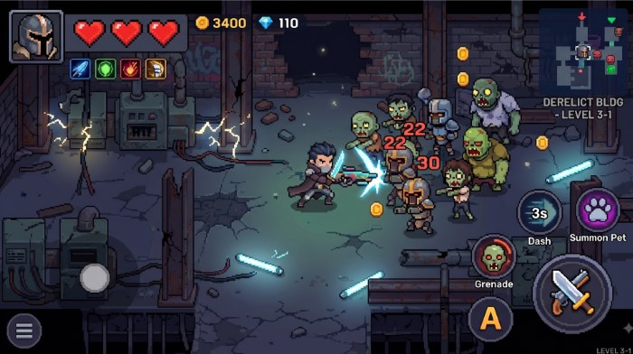
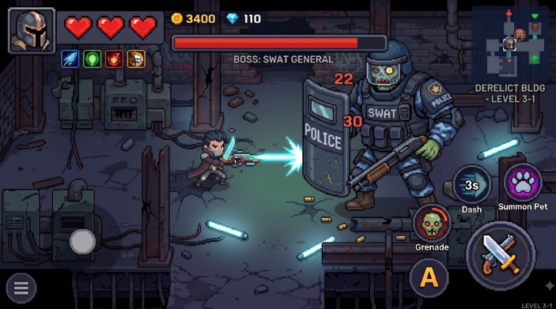
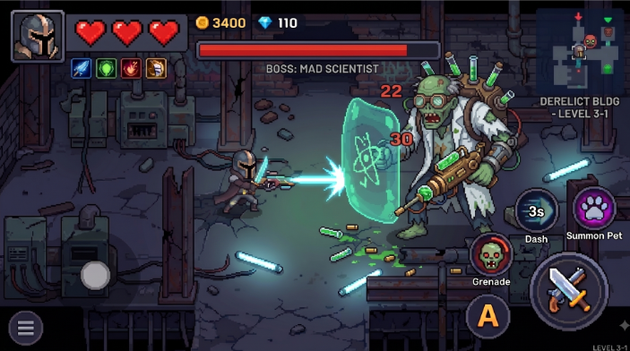
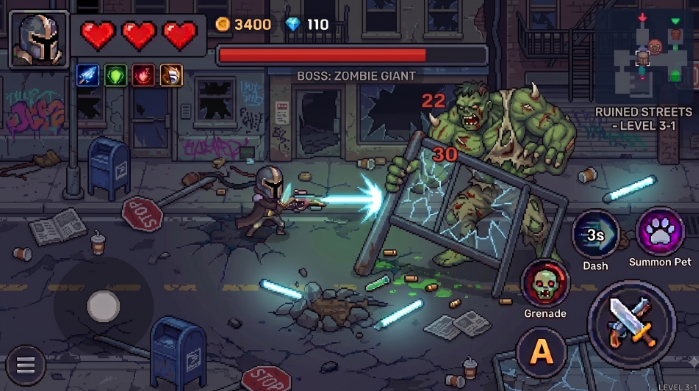

# Proyecto-Final-POO-2026

# Proyecto: Cazador de Zombies (Nombre a definir)

## 1. Integrantes del Equipo 

- Kornijew, Mirko 
- Navarro, Thiago 
- Perez, Joaquin 
- Oyarzo, Emiliano

## 2. Dominio y Alcance del Sistema 

### Descripción del problema
Se busca desarrollar una aplicación de escritorio de un videojuego de tipo **roguelike**, específicamente enfocado en la exploración de mazmorras y la acción frenética, ambientado en un mundo de apocalipsis zombie. El jugador tomará el control de un sobreviviente al apocalipsis que debe eliminar zombies en diferentes salas para sobrevivir.

### Objetivo del Sistema
El sistema será un juego funcional y extensible. El diseño aplicará rigurosamente la arquitectura **MVC**, los principios de la Programación Orientada a Objetos (POO) y patrones de diseño para facilitar la incorporación de nuevos personajes, habilidades, mapas y persistencia de datos.
 El objetivo del juego es eliminar al jefe final. Para esto debe encontrar una llave por cada nivel para acceder al siguiente. Al llegar a una determinada cantidad de salas completadas, se encuentra con un jefe al que tiene que eliminar.

### Idea general
El jugador es un sobreviviente de un apocalipsis zombie caminando por un mapa en 2D de perspectiva top-down donde aparecen justamente zombies que le quieren quitar vidas y él se tiene que defender, para eso cuenta con una pistola y un cuchillo. La pistola tiene balas y cooldown, en cada nivel aparece con una cantidad default de balas y se puede ir encontrado más de las mismas, además de otros potenciadores o power ups como por ejemplo de velocidad o cooldown. También podría encontrarse otras armas mejores que sean más eficientes y faciliten la jugabilidad. Todo esto el jugador lo utiliza para derrotar a los enemigos de cada etapa, y al llegar a la última debe derrotar a un jefe final para pasar el nivel. 
 El juego cuenta con varios escenarios en donde se desarrollaran los niveles del juego y también con variedad en cuanto a los enemigos como posibles jefes que tendrán mecánicas propias que los hagan únicos a comparación de los enemigos comunes que se encontrarán dispersos por distintas zonas del mapa.

### Funcionalidades Principales (Features)

**Gestión de Personajes y Clases:**
- Control de personajes con atributos propios (Vida, Ataque).
- Variedad de armas con formas de disparo diferentes.

**Interacciones con el entorno:**
- El jugador inicia con dos armas, una es para que tenga capacidad de hacer daño a los zombies a larga distancia, hay que tener cuidado porque esta balas tienen un límite, fomentando al jugador a usar cada bala con cuidado y con consciencia. El otro arma es un cuchillo con el que va a poder golpear a melee (ataque cuerpo a cuerpo)
- El jugador puede llegar a conseguir potenciadores o power-ups que se encuentran dispersos alrededor del mapa, estos incrementan sus stats ya sea de velocidad, cooldown del arma, más balas, etc. Beneficiando al jugador y dándole ventaja contra la situación. 
- Cuando entran a las salas donde están los enemigos las puertas se cierran, obligando al jugador a eliminarlos a todos para poder irse.

 **Mecánicas de Juego:**
- Si los zombies atacan al jugador, le quitan 1 corazón de 5 que representa su vida.
- Ciertos enemigos al ser eliminados dejan caer balas o power-ups.
- Hay salas donde hay cofres que tienen armas dentro o una tienda donde se puedan comprar armas, vida o power ups.

**Interfaz Gráfica (IGU):**
- Visualización del mapa (bosque, edificios, etc), en perspectiva top-down.
- Indicadores visuales de estado (barra de vida, cantidad de munición, power ups activos).
- Botón para iniciar la partida.

**Creación de enemigos:**
- Oleadas de una cantidad aleatoria de zombies dependiendo la mazmorra donde se encuentre.

**Persistencia de datos:**
- Guardado y consulta de mejores puntuaciones (High Scores) en una base de datos SQLite.

#### **Prototipo de la IGU (Wireframe)**

*Idea gráfica*

 

 

     
*Mapa del bosque (posible diseño)*

     
*Mapa del edificio (posible diseño)*

     
*Jefe final / por nivel -> Policia SWAT*

     
*Cientifico loco*

     
*Zombie gigante*

## 4. Stack Tecnológico 

- **Lenguaje:** Java 26
- **IDE:** Visual Studio Code & Intellij IDEA
- **Base de Datos:** SQL Lite
- **Framework de IGU:** Java Swing
- **Control de Versiones:** Git y GitHub Classroom
